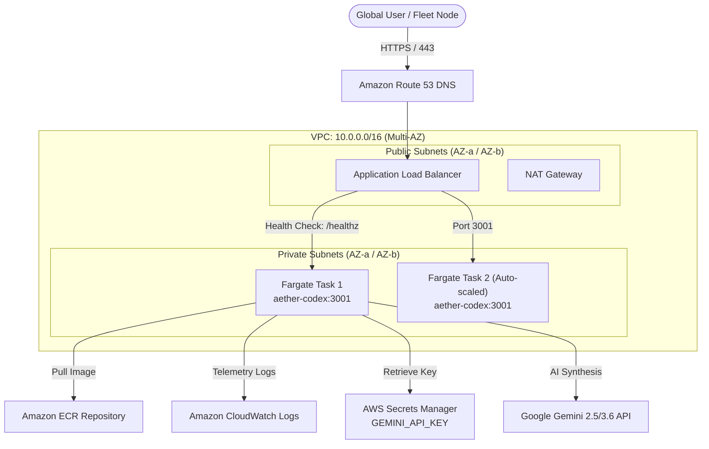

# AWS ECS Fargate Deployment Guide — Aetherium Codex & Digital Library

**Service:** `aether-codex`  
**Port:** `3001` (HTTP)  
**Healthcheck Path:** `/healthz`  
**Container Architecture:** `linux/amd64` (Docker Multi-stage)  
**Orchestrator:** Amazon Elastic Container Service (ECS) with AWS Fargate (Serverless)  
**Anchor Node:** `ESP32_01` (Tri-Node Cloud Fabric)  

---

## 1. Architecture Overview

Deploying the **Aetherium Codex & Digital Library** to AWS Fargate removes virtual machine overhead, providing an isolated, auto-scaling, serverless container environment with zero infrastructure maintenance.



---

## 2. Prerequisites

1. **AWS CLI v2** configured with administrator or deployment credentials:
   ```bash
   aws configure
   ```
2. **Docker Desktop** running locally (supporting `--platform linux/amd64`).
3. **Google Gemini API Key** for autonomous agent hermeneutics (`/api/nexus` and `/api/antigravity`).

---

## 3. One-Time AWS Infrastructure Provisioning

### Step 1: Create Amazon ECR Repository
```bash
aws ecr create-repository \
  --repository-name aether-codex \
  --region af-south-1 \
  --image-scanning-configuration scanOnPush=true \
  --encryption-configuration encryptionType=AES256
```

### Step 2: Store Gemini API Key in AWS Secrets Manager
```bash
aws secretsmanager create-secret \
  --name aether/gemini-api-key \
  --description "Gemini API Key for Aetherium Codex Vessel Logos" \
  --secret-string '{"GEMINI_API_KEY":"YOUR_ACTUAL_GEMINI_API_KEY"}' \
  --region af-south-1
```

### Step 3: Create CloudWatch Log Group
```bash
aws logs create-log-group \
  --log-group-name /ecs/aether-codex \
  --region af-south-1
```

### Step 4: Create ECS Fargate Cluster
```bash
aws ecs create-cluster \
  --cluster-name aether-cluster \
  --region af-south-1
```

### Step 5: IAM Execution Role
Ensure your ECS task execution role (`ecsTaskExecutionRole`) has access to ECR, CloudWatch, and the Secrets Manager secret. Attach the following inline policy:

```json
{
  "Version": "2012-10-17",
  "Statement": [
    {
      "Effect": "Allow",
      "Action": [
        "secretsmanager:GetSecretValue"
      ],
      "Resource": "arn:aws:secretsmanager:af-south-1:*:secret:aether/gemini-api-key*"
    }
  ]
}
```

---

## 4. Deploying via Automated Scripts

### Option A: Windows PowerShell
Execute from the repository root:
```powershell
.\scripts\deploy-fargate.ps1 -AwsRegion "af-south-1" -ClusterName "aether-cluster"
```

The script automatically:
1. Validates AWS credentials.
2. Creates the ECR repository if missing.
3. Authenticates Docker to Amazon ECR.
4. Compiles the production multi-stage Docker image (`linux/amd64`).
5. Pushes the image to ECR.
6. Renders and registers the new Task Definition (`ecs-task-definition.json`).
7. Triggers a zero-downtime rolling update on the ECS Fargate service.

### Option B: Linux / macOS / WSL
```bash
chmod +x ./scripts/deploy-fargate.sh
./scripts/deploy-fargate.sh
```

---

## 5. First-Time ECS Service Creation (ALB Integration)

If you have not yet created the ECS service behind an Application Load Balancer:

### 1. Create Target Group
```bash
aws elbv2 create-target-group \
  --name tg-aether-codex \
  --protocol HTTP \
  --port 3001 \
  --vpc-id vpc-xxxxxxxxx \
  --target-type ip \
  --health-check-protocol HTTP \
  --health-check-path /healthz \
  --health-check-interval-seconds 30 \
  --health-check-timeout-seconds 5 \
  --healthy-threshold-count 2 \
  --unhealthy-threshold-count 3 \
  --region af-south-1
```

### 2. Create Fargate Service
```bash
aws ecs create-service \
  --cluster aether-cluster \
  --service-name aether-codex-service \
  --task-definition aether-codex-library \
  --desired-count 1 \
  --launch-type FARGATE \
  --platform-version LATEST \
  --network-configuration "awsvpcConfiguration={subnets=[subnet-aaa,subnet-bbb],securityGroups=[sg-xxxxxx],assignPublicIp=ENABLED}" \
  --load-balancers targetGroupArn=arn:aws:elasticloadbalancing:af-south-1:xxxx:targetgroup/tg-aether-codex/xxxx,containerName=aether-codex,containerPort=3001 \
  --region af-south-1
```

---

## 6. Auto-Scaling Configuration

To ensure seamless performance during sudden surges in Codex queries or reading sessions:

```bash
# Register Scalable Target (1 to 4 tasks)
aws application-autoscaling register-scalable-target \
  --service-namespace ecs \
  --resource-id service/aether-cluster/aether-codex-service \
  --scalable-dimension ecs:service:DesiredCount \
  --min-capacity 1 \
  --max-capacity 4 \
  --region af-south-1

# Target Tracking Policy on 70% CPU Utilization
aws application-autoscaling put-scaling-policy \
  --service-namespace ecs \
  --resource-id service/aether-cluster/aether-codex-service \
  --scalable-dimension ecs:service:DesiredCount \
  --policy-name aether-codex-cpu-tracking \
  --policy-type TargetTrackingScaling \
  --target-tracking-scaling-policy-configuration '{
    "TargetValue": 70.0,
    "PredefinedMetricSpecification": {
      "PredefinedMetricType": "ECSServiceAverageCPUUtilization"
    },
    "ScaleOutCooldown": 60,
    "ScaleInCooldown": 300
  }' \
  --region af-south-1
```

---

## 7. Cost & Sizing Telemetry

| Resource | Size | Monthly Cost Estimate (af-south-1 / us-east-1) |
| :--- | :--- | :--- |
| **Fargate vCPU** | 0.5 vCPU ($0.04048/hr) | ~$14.50 |
| **Fargate Memory** | 1.0 GB RAM ($0.004445/hr) | ~$3.20 |
| **Amazon ECR Storage** | ~250 MB | ~$0.03 |
| **CloudWatch Logs** | 1 GB ingestion/month | ~$0.50 |
| **Total Baseline** | **Single 24/7 Fargate Task** | **~$18.23 / month** |

*Tip: For non-production development environments, configure ECS Scheduled Tasks or AWS Fargate Spot to reduce compute costs by up to 70% ($5.50/month).*
